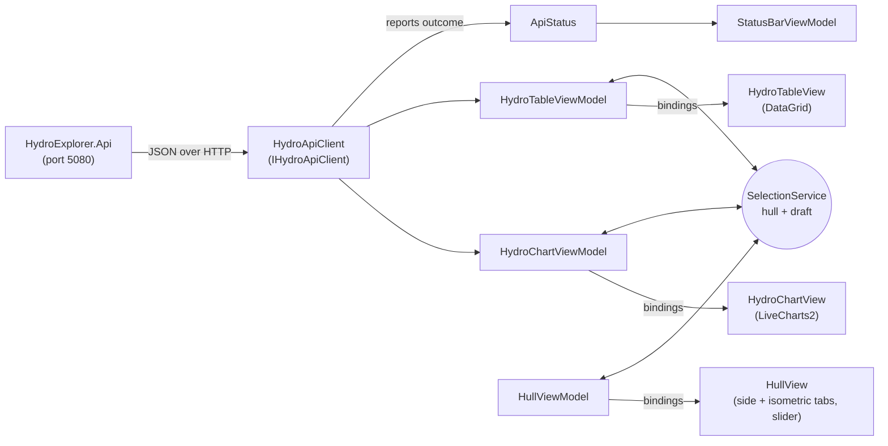

# Architecture

Hydrostatics Explorer shows one hull's hydrostatic data in three linked views: a paginated table, a
displacement curve and a hull view (side profile or isometric). The data comes from a local REST API. Design choices and their
reasons are in [DECISIONS.md](DECISIONS.md).

## Projects

| Project | Responsibility | Depends on |
|---|---|---|
| `HydroExplorer.Core` | Domain: `Hull`, `HydrostaticRow`, `CurvePoint` records; `HydrostaticsCalculator` (formulas); table generation and draft snapping; curve sampling and interpolation; CSV formatting (`HydrostaticCsvWriter`); `PagedResult<T>` / `Pager`; seed hulls. No UI, no HTTP. | nothing |
| `HydroExplorer.Api` | ASP.NET Core minimal API: `/api/hulls`, `/hydrostatics` (filter → sort → page), `/hydrostatics/page-of`, `/hydrostatics/curve`. Validation as ProblemDetails, simulated latency middleware, Swagger. | Core |
| `HydroExplorer.App` | Avalonia 11 MVVM desktop app: API client, shared selection, ViewModels, views, custom `HullProfileView` and `HullIsometricView` controls, `IFileSaveService` for CSV export. | Core (shares the records, so JSON maps onto the same types) |
| `*.Tests` | xUnit. Core: formulas and paging math. Api: `WebApplicationFactory` integration tests. App: ViewModels with `FakeHydroApiClient`, `HydroApiClient` with a stub HTTP handler, layout math. | the project under test |

## Data flow

1. **API → client.** `HydroApiClient` builds URLs (always with InvariantCulture), sends GETs, deserializes
   into Core records, and turns every failure (connection refused, timeout, non-2xx, bad JSON) into a
   `HydroApiException`. It reports each outcome to `ApiStatus`, which the status bar shows.
2. **Client → ViewModels.** The table ViewModel loads hulls and pages, and the chart ViewModel loads the
   curve. Each load sets `IsLoading`, cancels any older request, ignores stale responses, and on failure keeps
   the previous data and sets `ErrorMessage`.
3. **ViewModels → views.** Views bind to ViewModel properties with compiled bindings (`x:DataType`). Every
   property raises `PropertyChanged` (via CommunityToolkit's `[ObservableProperty]`), and buttons bind to
   `[RelayCommand]` commands whose `CanExecute` enables or disables them. Code-behind holds only view glue:
   header-click sorting, key routing, chart pixel → draft conversion, and scrolling a row into view.
4. **Composition.** `App.axaml.cs` registers everything as singletons in a `ServiceCollection`. `MainViewModel`
   receives the four child ViewModels, and `MainWindow` hands each child view its ViewModel through
   `DataContext="{Binding Table}"` etc.

## How the selection is shared

`SelectionService` (one DI singleton) holds the shared state: `SelectedHull` and `SelectedDraft`. Any view can
change it, and the others react to its `PropertyChanged` event:

| Source | Writes | Others react by |
|---|---|---|
| Table row click / ↑↓ keys | `SelectedDraft = row.Draft` | chart moves the marker (draft + displacement read off the loaded curve); hull view moves the waterline and slider |
| Chart click or drag | `SelectDraft(x)` (snaps to the 1 cm grid) | table highlights the row if it's on the current page, otherwise calls `page-of`, loads that page and highlights it |
| Draft slider | `SelectDraft(value)` | as above |
| Hull selector | `SelectedHull` (clears the draft) | chart reloads the curve; table loads page 1; hull view redraws |

The draft, rather than a table row, is the shared state so that the chart and slider can update every view
instantly. Only the table needs the network, and only when the draft is on another page.

## React → Avalonia / WPF concept map

| React | Avalonia (this app) | WPF |
|---|---|---|
| Component | `UserControl` (`HydroTableView`) or a custom `Control` (`HullProfileView`) | `UserControl` / custom `Control` / `FrameworkElement` |
| JSX | XAML (`.axaml`) | XAML (`.xaml`) |
| Props passed to a child | `DataContext="{Binding Table}"` plus `{Binding}` to that object's properties | same |
| A component's own props API | `StyledProperty` (`HullProfileView.DraftProperty`) | `DependencyProperty` |
| State + `setState` → re-render | ViewModel property raising `INotifyPropertyChanged` (`[ObservableProperty]`) | same (`INotifyPropertyChanged`) |
| Event handler prop (`onClick`) | `ICommand` (`[RelayCommand]`), with `CanExecute` for enabled state | `ICommand` |
| `useEffect([dep])` | `partial void OnSelectedHullChanged(...)` or a `PropertyChanged` subscription | `PropertyChanged` handler or `DependencyProperty` change callback |
| Lifting state up / Context | `SelectionService` singleton injected via DI | same pattern; or `Messenger` / event aggregator |
| `items.map(item => <Row/>)` | `ItemsSource` + `DataTemplate` (hull ComboBox) | same |
| CSS classes | Style selectors: `Border.panel`, `Classes.connected="{Binding …}"` | keyed `Style` resources (no classes) |
| Canvas drawing in `useEffect` | `override Render(DrawingContext)` + `AffectsRender` | `OnRender(DrawingContext)` + `AffectsRender` metadata |
| Mocking `fetch` in tests | `FakeHydroApiClient`, or a stub `HttpMessageHandler` | same |
